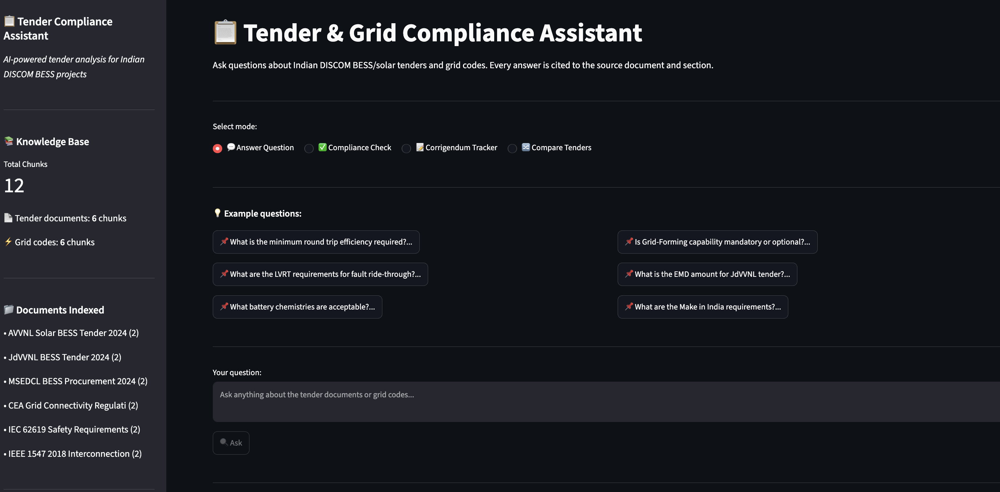
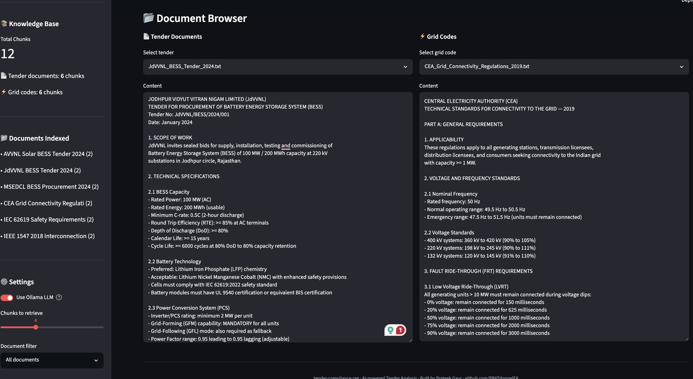

# tender-compliance-rag 📋

> **AI-powered Tender & Grid Compliance Assistant for Indian DISCOM BESS Projects**
> Section-aware chunking · sentence-transformers embeddings · numpy cosine search · optional Groq LLM · Streamlit Cloud

---

## 🌐 Live Demo

[](https://tender-compliance-rag-ej3hpahnvtu6yaf3bvtijw.streamlit.app/)

> Try it now — no installation required. Ask: "Is Grid-Forming capability mandatory?" or "What changed in the JdVVNL corrigendum?"

---

## 🎯 What This Is

A Retrieval-Augmented Generation (RAG) system that indexes Indian power sector tender documents and grid codes, then answers compliance questions in natural language — with every answer **cited to the exact source document and section**.

Built directly from real-world experience analyzing JdVVNL, AVVNL, and MSEDCL BESS tenders.

This repo is the **Streamlit Cloud deployment** (`streamlit_app.py`) — a single, self-contained app with all documents pre-indexed in the code, so the live demo above needs no setup. See "How the live demo actually works" below for the exact architecture.

---

## 📸 Screenshots

### Tender & Grid Compliance Assistant — 4 Query Modes


### Document Browser — Tenders & Grid Codes


---

## 💡 Why This Exists

Indian DISCOM tenders for BESS and solar projects are 100–200 page documents. Missing one requirement — a corrigendum that changed Grid-Forming from "preferred" to "mandatory" — can disqualify an entire bid worth ₹500 crore.

This tool lets a bid manager ask in plain English:
- *"Is Grid-Forming capability mandatory?"*
- *"What changed in the corrigendum?"*
- *"Does our 83% RTE meet the MSEDCL requirement?"*
- *"Compare cycle life requirements across all three tenders"*

And get a cited answer in seconds.

---

## 🏗️ How the live demo actually works

```
Tender PDFs + Grid Codes (pre-chunked, inline in streamlit_app.py)
        ↓
Section-aware chunking (400 words, 80-word overlap, numbered-heading detection)
        ↓
Embeddings: sentence-transformers (all-MiniLM-L6-v2), runs on CPU — no Ollama needed
        ↓
Query → cosine similarity search in numpy (no FAISS)
        ↓
Top-k chunks + citations
        ↓
Answer generation:
  • If a GROQ_API_KEY secret is set → Groq-hosted Mixtral (mixtral-8x7b-32768) writes
    the answer from the retrieved chunks
  • Otherwise (current default on this deployment) → the top cited chunks are shown
    directly, with relevance scores — no LLM call, just retrieval + citation
        ↓
Streamlit UI (4 modes)
```

**Honest note on the compliance-check mode:** its colored PASS/FAIL badge is driven by the LLM's answer text. Without a Groq key configured, the fallback answer doesn't contain those literal words, so the badge won't light up right now — you'll still get the correct cited sections, just without the colored verdict. Adding a free Groq API key as a Streamlit secret switches the app to full LLM-generated answers with the PASS/FAIL badge.

---

## 📦 What's in this repo

```
tender-compliance-rag/
├── streamlit_app.py              # The entire live app — documents, chunking, retrieval,
│                                  # optional Groq generation, and the Streamlit UI
├── requirements.txt               # Local/dev requirements
├── requirements_cloud.txt         # Streamlit Cloud requirements
├── screenshots/
│   ├── compliance_assistant.png
│   └── document_browser.png
└── README.md
```

A fuller local version of this idea (FAISS, Ollama-hosted Mistral, a multi-file ingestion pipeline) is a design I've built before, but this public repo is deliberately just the single-file Streamlit Cloud app above — that's what's actually running behind the live demo link.

---

## ⚙️ Tech Stack (this deployment)

| Layer | Technology |
|---|---|
| Language | Python 3.10+ |
| Embeddings | sentence-transformers — all-MiniLM-L6-v2 (CPU) |
| LLM (optional) | Groq API — Mixtral 8x7B, only if `GROQ_API_KEY` is set as a secret |
| Vector Search | numpy cosine similarity (no FAISS in this deployment) |
| Chunking | Section-aware (numbered heading detection) |
| Dashboard | Streamlit |

---

## 🚀 Quick Start (run it yourself)

```bash
git clone https://github.com/PRATdoppelEK/tender-compliance-rag.git
cd tender-compliance-rag

pip install -r requirements_cloud.txt

# Optional: enable LLM-generated answers instead of the retrieval-only fallback
export GROQ_API_KEY=your_free_groq_key

streamlit run streamlit_app.py
```

No Ollama, no separate ingestion step — all three tenders and three grid codes are pre-chunked inline in `streamlit_app.py`.

---

## 💬 4 Query Modes

### 1. Answer Question
Ask anything about tender requirements:
```
Q: What is the minimum round trip efficiency required?
A: JdVVNL requires >= 85% RTE (AC terminals). MSEDCL requires >= 85% AC-AC.
   AVVNL specifies >= 87% including transformer losses.
   [Source: JdVVNL_BESS_Tender — Section 2.1 BESS Capacity]
```

### 2. Compliance Check
Check if your specs meet requirements (PASS/FAIL badge needs a Groq key — see above):
```
Q: Does 83% round trip efficiency meet the MSEDCL requirement?
VERDICT: FAIL
REQUIREMENT: >= 85% AC-AC (MSEDCL Tender Section 2.2)
ASSESSMENT: 83% is 2% below the minimum threshold.
RECOMMENDATION: Improve system design or negotiate threshold.
```

### 3. Corrigendum Tracker
Track all changes across amendments:
```
Q: What changed in the JdVVNL corrigendum?
- Corrigendum 1: Grid-Forming changed from "preferred" to "MANDATORY"
- Corrigendum 2: Cycle life increased from 5000 to 6000 cycles
- Corrigendum 3: Added IEC 62443 cybersecurity requirement
```

### 4. Compare Tenders
Side-by-side comparison:
```
Q: Compare round trip efficiency requirements across tenders
| Tender  | RTE Requirement | Basis         |
|---------|-----------------|---------------|
| JdVVNL  | >= 85%          | AC terminals  |
| MSEDCL  | >= 85%          | AC-AC         |
| AVVNL   | >= 87%          | Including Tx  |
Strictest: AVVNL (87% including transformer losses)
```

---

## 📄 Documents Indexed

### Tender Documents
| Document | Capacity | Utility |
|---|---|---|
| JdVVNL BESS Tender 2024 | 100 MW / 200 MWh | Jodhpur, Rajasthan |
| AVVNL Solar + BESS 2024 | 50 MW + 25 MW/50 MWh | Ajmer, Rajasthan |
| MSEDCL BESS Procurement 2024 | 500 MW / 1000 MWh | Maharashtra |

### Grid Codes
| Document | Standard | Scope |
|---|---|---|
| CEA Grid Connectivity Regulations 2019 | Indian | LVRT, frequency, protection |
| IEC 62619:2022 | International | Lithium battery safety |
| IEEE 1547-2018 | International | DER interconnection |

All documents are synthetic, modelled on real tender structures and requirements — not actual confidential bid documents.

---

## 🔒 Privacy

- Document text is embedded directly in the app; nothing confidential
- If a Groq key is configured, the question and retrieved chunks are sent to Groq's API for answer generation; without one, everything stays inside the Streamlit Cloud instance
- Synthetic tender data only — suitable to share publicly

---

## 📅 Build Status

| Component | Status |
|---|---|
| Synthetic document set (3 tenders + 3 grid codes) | ✅ Done |
| Section-aware chunking | ✅ Done |
| sentence-transformers embedding pipeline | ✅ Done |
| numpy cosine similarity search | ✅ Done |
| Optional Groq LLM answer generation | ✅ Done |
| Retrieval-only fallback (no LLM key) | ✅ Done |
| Source citation system | ✅ Done |
| Streamlit dashboard (4 modes) | ✅ Done |
| Streamlit Cloud deployment | ✅ Done |

---

## 👤 Author

**Prateek Gaur** — ML Engineer, Munich
GitHub: [@PRATdoppelEK](https://github.com/PRATdoppelEK)

---

## 📄 License

MIT
